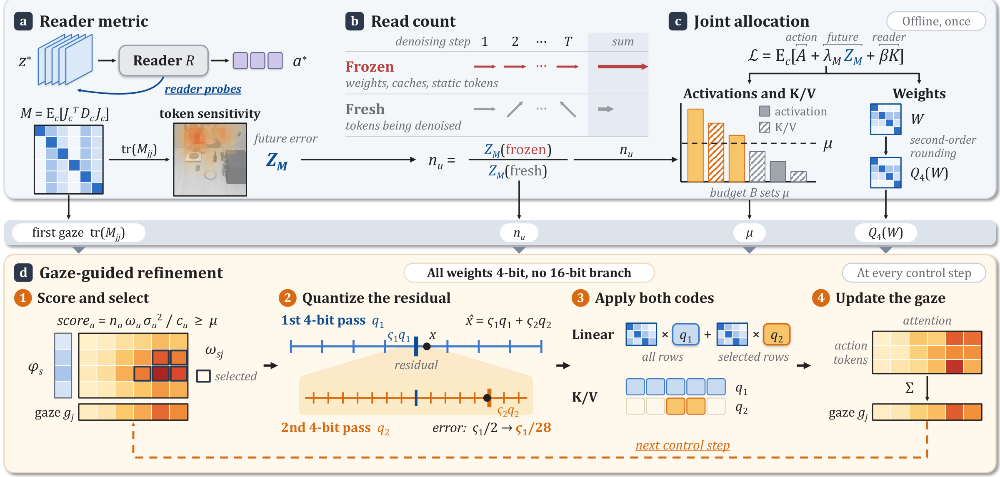

# LAQ

**Don't Lose the Future: Latent-Aware 4-Bit Quantization of World Action Models**

LAQ is a post-training quantization framework for world action models (WAMs). It brings weights, activations and
key-value caches to 4 bits (W4A4KV4) while preserving the predicted future that the action is conditioned on.

## Method

- **Reader metric.** Future error is measured by its effect on the action.
- **Read count.** Each rounding error is weighted by the number of denoising steps that read it.
- **Closed-form allocation.** The two quantities give the allocation of precision over activations and caches a
  closed-form solution.
- **Gaze-guided refinement.** The tokens the action attends to receive a second 4-bit pass in the denoising loop and
  in the cache.

All weights stay at 4 bits, with no high-precision branch and no per-task recalibration.

## Release

| Item | Status |
| --- | --- |
| Paper | Coming soon |
| Code | Coming soon |
| Fast-WAM-LAQ checkpoint (W4A4KV4) | Coming soon |
| Cosmos-Policy-LAQ checkpoint (W4A4KV4) | Coming soon |

## License

The code is released under the [Apache-2.0 license](LICENSE). Model weights retain the licenses of their original
models.
