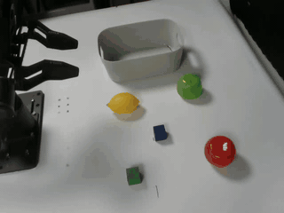
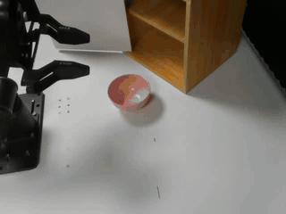
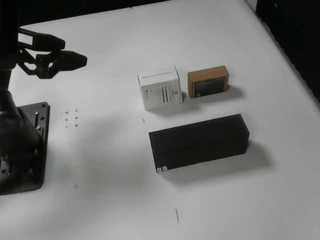

<p align="center">
  
</p>

<h1 align="center">LAQ</h1>

<p align="center"><b>Don't Lose the Future: Latent-Aware 4-Bit Quantization of World Action Models</b></p>

<p align="center">
  <a href="https://arxiv.org/abs/2611.25614"></a>
  <a href="https://huggingface.co/SunnyRay114514/LAQ-FastWAM-LIBERO"></a>
  <a href="https://huggingface.co/SunnyRay114514/LAQ-Cosmos-Policy-LIBERO"></a>
  
  
  
  <a href="LICENSE"></a>
</p>

<p align="center"><b>4-bit weights, activations and key-value caches for world action models, with the predicted future preserved.</b></p>

<p align="center">
  📄 <a href="https://arxiv.org/abs/2611.25614"><b>Paper</b></a>
  &nbsp;|&nbsp;
  🤗 <a href="#model-zoo"><b>Models</b></a>
  &nbsp;|&nbsp;
  🤖 <a href="#real-world"><b>Real Robot</b></a>
  &nbsp;|&nbsp;
  ⚡ <a href="#quick-start"><b>Quick Start</b></a>
  &nbsp;|&nbsp;
  📝 <a href="#citation"><b>Citation</b></a>
</p>

<p align="center">
  
</p>

World action models (WAMs) predict how a scene will evolve and condition their actions on this predicted future.
LAQ is a post-training quantization framework that brings a WAM to **W4A4KV4** and preserves the predicted future
where it is written, stored and read. All weights stay at 4 bits, with no high-precision branch and no per-task
recalibration.

| | Fast-WAM | Cosmos-Policy |
| --- | :---: | :---: |
| **LIBERO-Plus average success (W4A4KV4)** | **76.4%** | **83.3%** |

> Both are within **1.2 points** of the 16-bit models. LAQ compresses the model by **3.8×**, reduces the peak GPU
> memory of the whole policy by **2.3×**, and runs **1.66×** faster than the 16-bit model.

<details>
<summary>📖 <b>Table of Contents</b></summary>

- [🤖 Real-World Rollouts](#real-world)
- [🔍 Method](#method)
- [🤗 Model Zoo](#model-zoo)
- [⚡ Quick Start](#quick-start)
- [📁 Repository Layout](#repository-layout)
- [📝 Citation](#citation)
- [📜 License](#license)

</details>

---

<a id="real-world"></a>
## 🤖 Real-World Rollouts

Fast-WAM quantized to W4A4KV4 with LAQ, controlling a real AgileX PiPER arm (played at 2× speed).

<table>
  <tr>
    <td align="center" width="33%"></td>
    <td align="center" width="33%"></td>
    <td align="center" width="33%"></td>
  </tr>
  <tr>
    <td align="center"><b>Pick-and-place</b></td>
    <td align="center"><b>Shelf placement</b></td>
    <td align="center"><b>Box stacking</b></td>
  </tr>
</table>

---

<a id="method"></a>
## 🔍 Method

LAQ decides which tokens deserve more precision, and spends that precision without leaving 4 bits.

- **Reader metric.** Future error is measured by its effect on the action, so precision goes where the reader of the
  future looks.
- **Read count.** A rounding error that is written once and read at every denoising step counts once per read. Each
  error is weighted by the number of steps that read it.
- **Closed-form allocation.** Together the two quantities give the allocation of precision over activations and
  caches a closed-form solution with one threshold.
- **Gaze-guided refinement.** The tokens the action attends to receive a second 4-bit pass in the denoising loop and
  in the cache. The attention of the action tokens in one control step selects the tokens of the next.

---

<a id="model-zoo"></a>
## 🤗 Model Zoo

| Model | Base model | Precision | Benchmark | HF Hub |
| --- | --- | :---: | :---: | --- |
| Fast-WAM-LAQ | [Fast-WAM](https://github.com/yuantianyuan01/FastWAM) | W4A4KV4 | LIBERO | [SunnyRay114514/LAQ-FastWAM-LIBERO](https://huggingface.co/SunnyRay114514/LAQ-FastWAM-LIBERO) |
| Cosmos-Policy-LAQ | [Cosmos-Policy](https://huggingface.co/nvidia/Cosmos-Policy-LIBERO-Predict2-2B) | W4A4KV4 | LIBERO | [SunnyRay114514/LAQ-Cosmos-Policy-LIBERO](https://huggingface.co/SunnyRay114514/LAQ-Cosmos-Policy-LIBERO) |

Each checkpoint holds the packed 4-bit weights of the transformer blocks (`weights.safetensors`) and the calibrated
allocation (`config.json`). The remaining layers, the VAE and the text encoder come from the original model.

---

<a id="quick-start"></a>
## ⚡ Quick Start

```bash
git clone https://github.com/SunnyRaymond/LAQ.git
cd LAQ
# Install PyTorch for your CUDA version first.
pip install -e .
```

Build the original model with its own codebase, then attach LAQ. The checkpoint is downloaded from the Hub by name.

```python
from laq import fastwam

model = ...                                   # a Fast-WAM policy loaded with the Fast-WAM codebase
state = fastwam.attach(model, "fastwam-libero")

state.reset()                                 # at the start of every episode
action = model.infer_action(...)              # inference as usual, now at W4A4KV4
```

```python
from laq import cosmos

model = ...                                   # a Cosmos-Policy model loaded with the Cosmos-Policy codebase
state = cosmos.attach(model, "cosmos-policy-libero")
state.reset()
```

`attach` also accepts a local checkpoint directory. `state.reset()` makes the first query of an episode use the
offline gaze; every later query uses the gaze of the query before it.

---

<a id="repository-layout"></a>
## 📁 Repository Layout

```
.
├── laq/
│   ├── quant.py          # Hadamard transforms, 4-bit quantizers, GPTQ, weight packing
│   ├── rotations.py      # roles of the block-level Linears and their input rotations
│   ├── fastwam.py        # LAQ on Fast-WAM: refinement, gaze, allocation, calibration
│   ├── cosmos.py         # LAQ on Cosmos-Policy
│   ├── graphs.py         # CUDA graphs of the policy call
│   ├── int4/             # integer runtime: packed 4-bit operands on the INT4 tensor cores
│   ├── checkpoint.py     # checkpoint format
│   └── hub.py            # released checkpoints
├── tests/                # CPU tests of the arithmetic
└── assets/               # README figures
```

---

<a id="citation"></a>
## 📝 Citation

```bibtex
@article{guo2026laq,
  title={Don't Lose the Future: Latent-Aware 4-Bit Quantization of World Action Models},
  author={Guo, Yichen and Chen, Yanlong and Zhang, Xinyue and Liu, Mohan and Zhang, Song and Li, Yawei},
  journal={arXiv preprint arXiv:2611.25614},
  year={2026}
}
```

---

<a id="license"></a>
## 📜 License

The code is released under the [Apache-2.0 license](LICENSE). Model weights retain the licenses of their original
models. See the [third-party notices](THIRD_PARTY_NOTICES.md).
